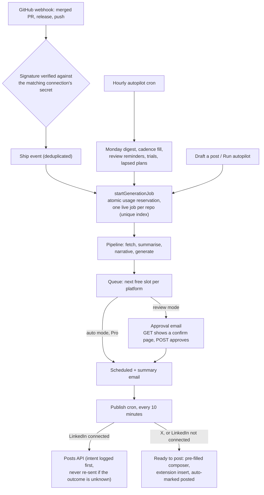

<div align="center">

# CommitFlex

**Build in public on autopilot. You ship; CommitFlex writes the post.**

Sign in with GitHub, pick your repos and answer five questions (or take the recommended settings). From then on, every merged pull request, published release and Monday digest becomes a LinkedIn post and an X post in your voice. Drafts land in a content calendar, you approve them from an email or the app, LinkedIn posts publish on their own at their slot, and X posts open pre-filled (or get inserted by the Chrome extension) so you only press Post.

[](https://commit-flex.vercel.app)


[What it does](#what-it-does) · [Automation flows](#automation-flows) · [Pricing](#plans-and-pricing) · [Chrome extension](#chrome-extension) · [Run it](#getting-started) · [Deploy](#deployment)

</div>

---

## What it does

Developers ship real work every week and almost never write about it. CommitFlex reads what you actually shipped (commit messages, pull request descriptions, release notes; never your source files), drops the noise, redacts anything that looks like a secret, and writes posts tuned to your voice. Then it schedules them, asks for your approval and publishes.

**Autopilot**
- **Ship moments.** A merged pull request (human author, 20+ changed lines) or a published release starts a draft automatically through the repo's GitHub webhook.
- **Weekly digest.** Every Monday from 06:00 in your timezone, repos with at least three meaningful commits get a digest draft. A missed Monday is caught up on the next cron run.
- **Cadence fill (Pro).** Once a week up to every weekday: an empty slot in the next 48 hours is filled from your most active repo.
- **Content calendar.** Week and month views with open slots from your schedule. Click an open slot to fill it with an approved or unqueued draft.
- **Approval by email.** Each draft arrives with an Approve button. The link opens a confirmation page showing the post; nothing changes until you confirm there, so mail scanners that open every link can't approve anything.
- **Publishing.** LinkedIn through the official Posts API (Share on LinkedIn, `w_member_social`). X through a pre-filled composer link, or the Chrome extension inserts the text and marks it posted once it sees the post in your timeline.

**Manual drafting**
- **Draft a post** from a recent merged pull request (a searchable list, newest undrafted one preselected), a release (newest selected) or a date range. Paste a link only if you want to.
- Edit in a side sheet with **Save and approve**, **Rewrite** and **Variants** (Pro), and a guard against losing unsaved edits.

**Onboarding that gets to a first draft fast**
- Reading and summarising the last two weeks of commits starts in the background as soon as you pick repos, so the first drafts arrive seconds after you finish the questions.
- **Use recommended settings** skips the questions entirely: five clicks from sign-in to a draft.
- The success screen shows your first draft with an Approve button instead of redirecting you away.

**Insights**
- Posting streak (weeks in a row with a post), posts per week against your cadence, ship-to-post rate (merged PRs and releases that got a post) and the median time from merge to post. Pro adds 30 and 90 day ranges and a breakdown by source.

**Teams (Team plan)**
- Up to five reviewers get approval emails. Their links can only approve. If the owner edits a post a reviewer already approved, it goes back for review.

## Automation flows



The safety rails, in short:

| Concern | How it's handled |
|---|---|
| Mail scanners approving drafts | Approval links are read-only (GET resolves the token and shows a confirmation page). The state change is a same-origin POST. Tokens are bound to the actions they were issued for and consumed with a single conditional `UPDATE … WHERE used_at IS NULL`. |
| Double publishing | Every publish claims the row first with a conditional status transition. Before calling LinkedIn the publisher writes an intent row in `publish_log`; a stuck row with an open intent is parked as failed ("We may have posted this already") instead of being retried. |
| Racing webhooks and cron runs | A partial unique index allows one live job per repo. Losing inserts get the winner's id back and their usage reservation refunded. |
| Plan limits under concurrency | Monthly generations are reserved with one `INSERT … ON CONFLICT DO UPDATE … WHERE count + n <= max`, before any model call, and refunded when the work fails. |
| Someone registering your repo | Connecting reads the repository from GitHub with the user's own token and requires push access; name, URL and default branch come from GitHub, not the request. Webhooks try every live connection for the repo and use the one whose secret verifies. |
| Duplicate Razorpay deliveries | Each event is claimed exclusively (`processing_started_at`), and subscription inserts are idempotent. |
| Lapsed subscriptions | Run-time checks only act on the repos the current plan covers, and the hourly cron brings lapsed accounts back within Free. |
| Rate limits across serverless instances | Shared fixed-window counters in Postgres (`rate_limit_buckets`), with an in-memory fallback. |
| Secrets at rest | GitHub OAuth tokens, LinkedIn tokens and per-repo webhook secrets are encrypted with AES-256-GCM (`OAUTH_TOKEN_ENCRYPTION_KEY`). |
| Repeat free trials | A non-cascading `trial_claims` table keeps a SHA-256 of the GitHub account id, so deleting and recreating an account doesn't grant a new trial. |

## Plans and pricing

Every account starts with **14 days of Pro**, then moves to Free unless you upgrade. Billing runs on Razorpay subscriptions in **INR** (UPI or card) or **USD** (card); the currency is picked from the visitor's location and can be switched.

| | Free | Pro | Team |
|---|---|---|---|
| Price (month / year) | ₹0 / $0 | ₹499 or $9 / ₹4,990 or $90 | ₹1,999 or $29 / ₹19,990 or $290 |
| Repos watched | 1 | 10 | 40 |
| Drafts a month | 10 | 150 | 600 |
| Posts in the queue | 3 | 60 | 250 |
| Voice profiles | 1 | 5 | 20 |
| Weekly digest | Yes | Yes | Yes |
| Merged PR and release drafts | | Yes | Yes |
| Fixed posting cadence | | Yes | Yes |
| Publish directly to LinkedIn | | Yes | Yes |
| Auto-approve, variants | | Yes | Yes |
| Insights over 30 and 90 days | 7 days | Yes | Yes |
| Email reviewers | | | Up to 5 |
| Chrome extension | Yes | Yes | Yes |

Limits are enforced on the server (`lib/plans.ts`, `lib/billing/catalog.ts`); the UI only explains them.

## Chrome extension

A Manifest V3 extension in [`extension/`](extension) (vanilla TypeScript, bundled with esbuild):

- **LinkedIn and X:** a queue button in the composer. Insert puts the draft at the cursor; when the post shows up in your feed, the extension marks it posted for you (with Undo).
- **Popup:** your queue across platforms, with **Approve** for drafts that need review, Copy, Insert and Open.
- **GitHub:** a "Draft a post about this" button on pull request and release pages. If the repository isn't connected yet, one click connects it and starts the draft.
- Uses the app's fonts (bundled, SIL OFL) and theme tokens.

**Install while the Chrome Web Store listing is in review:** `pnpm build` packs `public/commitflex-extension.zip` (pointed at your deployment) and the app serves it at `/extension/download`. Users download it, unzip it, open `chrome://extensions`, turn on Developer mode and choose **Load unpacked**. The `/extension` page walks through this and then connects the extension with one click (no token to copy). Once the listing is live, set `NEXT_PUBLIC_CHROME_EXTENSION_URL` and the page switches to the store button.

For development: `pnpm ext:build` (or `node extension/build.mjs --watch`) writes `extension/dist` for `http://localhost:3000`. See [extension/README.md](extension/README.md).

## Tech stack

| Layer | Technology |
|---|---|
| Framework | Next.js 14 (App Router), React 18, TypeScript 5 |
| Auth | Auth.js v5 (GitHub OAuth, JWT sessions, Drizzle adapter with encrypted tokens) |
| Database | Postgres (Neon) via postgres.js, Drizzle ORM and drizzle-kit |
| AI | Gemini (`gemini-2.5-flash`) with an Anthropic fallback, behind a shared circuit breaker (`lib/ai/provider.ts`) |
| GitHub | `@octokit/rest` (REST + GraphQL) and per-repo webhooks with HMAC-SHA256 |
| Publishing | LinkedIn Posts API, X intent URLs, the Chrome extension |
| Billing | Razorpay subscriptions (INR and USD) |
| Email | Resend and React Email |
| UI | Tailwind CSS 3 with design tokens, `@base-ui/react`, lucide-react, `motion` |
| Testing | Vitest 4, jsdom, Testing Library |

## Getting started

### Prerequisites

- Node.js 20 and pnpm 9
- Postgres (a hosted Neon database is easiest; local Postgres works without SSL)
- A [GitHub OAuth App](https://github.com/settings/developers) with callback `http://localhost:3000/api/auth/callback/github`
- A [Gemini API key](https://aistudio.google.com/app/apikey)

### Setup

```bash
git clone https://github.com/ritvikjaiswal02/CommitFlex.git
cd CommitFlex
pnpm install
cp .env.example .env.local      # fill in the values
pnpm db:migrate                 # applies ./drizzle (0000 to 0007)
pnpm dev                        # http://localhost:3000
```

### Scripts

| Command | What it does |
|---|---|
| `pnpm dev` | Next.js dev server |
| `pnpm build` | Packs the extension zip into `public/`, then `next build` |
| `pnpm build:app` | `next build` only |
| `pnpm start` | Serve the production build |
| `pnpm typecheck` | `tsc --noEmit` |
| `pnpm test` / `pnpm test:run` | Vitest (watch / once) |
| `pnpm lint` / `pnpm lint:tokens` | ESLint / fail on arbitrary font sizes and radii (design tokens only) |
| `pnpm db:generate` / `pnpm db:migrate` / `pnpm db:studio` | Drizzle migrations and studio |
| `pnpm db:encrypt-secrets` | One-off: encrypt GitHub tokens and webhook secrets stored before encryption was enabled (`--dry-run` to count) |
| `pnpm ext:build` / `pnpm ext:zip` | Build the extension into `extension/dist` (and a Web Store zip) |

### Environment variables

[.env.example](.env.example) lists every variable with a comment. Summary:

| Variable | Required | Purpose |
|---|---|---|
| `DATABASE_URL` | Yes | Postgres connection string |
| `NEXTAUTH_URL`, `NEXTAUTH_SECRET` | Yes | Auth.js URL and JWT secret (`AUTH_SECRET` also works) |
| `GITHUB_CLIENT_ID`, `GITHUB_CLIENT_SECRET` | Yes | GitHub OAuth app (scopes `read:user user:email repo admin:repo_hook`) |
| `GEMINI_API_KEY` | Yes | Primary AI provider |
| `OAUTH_TOKEN_ENCRYPTION_KEY` | Production | 64 hex chars. Encrypts GitHub and LinkedIn tokens and webhook secrets |
| `APP_URL` | Production | Canonical origin for emails, approval links and OAuth redirects |
| `CRON_SECRET` | Production | Bearer secret for `/api/cron/*` |
| `WEBHOOK_BASE_URL` | No | Origin GitHub calls for webhooks (a tunnel in local dev) |
| `RATE_LIMIT_STORE` | No | `memory` keeps rate limits per instance; default is the shared Postgres store |
| `RESEND_API_KEY`, `EMAIL_FROM`, `SUPPORT_EMAIL` | No | Email delivery (console when unset) |
| `LINKEDIN_CLIENT_ID`, `LINKEDIN_CLIENT_SECRET`, `LINKEDIN_API_VERSION` | No | Direct LinkedIn publishing |
| `ANTHROPIC_API_KEY`, `AI_PROVIDER`, `ANTHROPIC_MODEL` | No | AI fallback and provider choice |
| `RAZORPAY_KEY_ID`, `RAZORPAY_KEY_SECRET`, `RAZORPAY_WEBHOOK_SECRET` | For billing | Razorpay API and webhook |
| `RAZORPAY_PLAN_{PRO,TEAM}_{MONTHLY,YEARLY}_{INR,USD}` | For billing | The eight Razorpay plan ids |
| `NEXT_PUBLIC_CHROME_EXTENSION_URL` | No | Chrome Web Store listing; unset means the early-access zip |
| `COMMITFLEX_APP_URL` | No | Build-time: origins baked into the extension (defaults to `APP_URL`) |

> **Webhooks in local dev:** GitHub can't reach `localhost`. Set `WEBHOOK_BASE_URL` to a tunnel (smee.io or ngrok) before connecting a repo. Manual drafting works without one.

## Deployment

1. Import the repo into Vercel and set the variables above (`APP_URL` and `NEXTAUTH_URL` to your domain).
2. Point a production GitHub OAuth App at `https://<your-domain>/api/auth/callback/github`.
3. Run `pnpm db:migrate` against the production database before the first deploy and after every schema change. Migration `0007` adds the shared rate-limit table, trial claims, approval-token actions, the one-live-job-per-repo index (it closes duplicate live jobs first) and the onboarding prefetch columns.
4. If the database already holds plaintext tokens, set `OAUTH_TOKEN_ENCRYPTION_KEY` and run `pnpm db:encrypt-secrets` once. Reading falls back to plaintext, so this can happen after the deploy.

### Cron

`vercel.json` schedules:

| Path | Schedule | Does |
|---|---|---|
| `/api/cron/publish` | daily 03:30 UTC | Publishes due posts, retries, hands off X posts |
| `/api/cron/autopilot` | daily 03:00 UTC | Monday digests, cadence fill, review reminders, trial emails, LinkedIn expiry, lapsed plans |

Vercel Hobby only allows daily crons, so `.github/workflows/cron.yml` calls both endpoints every 10 minutes. Add two repository secrets for it (Settings → Secrets and variables → Actions): `APP_URL` (for example `https://commit-flex.vercel.app`) and `CRON_SECRET` (the same value as in Vercel). Both endpoints require `Authorization: Bearer $CRON_SECRET` and are idempotent, so running them more often is safe. On Vercel Pro you can move the schedules back into `vercel.json` instead.

### Razorpay

1. Create the eight plans (Pro and Team, monthly and yearly, INR and USD) in the Razorpay Dashboard and put their ids in the `RAZORPAY_PLAN_*` variables.
2. Add a webhook to `https://<your-domain>/api/webhooks/razorpay` with a secret (`RAZORPAY_WEBHOOK_SECRET`) and subscribe it to `subscription.activated`, `charged`, `pending`, `halted`, `cancelled`, `completed`, `paused` and `resumed`.
3. Checkout is created by `POST /api/billing/checkout` and verified by `POST /api/billing/verify`; the webhook is the source of truth for status changes.

### LinkedIn

Create a LinkedIn app with the **Sign In with LinkedIn using OpenID Connect** and **Share on LinkedIn** products, add the redirect `https://<your-domain>/api/integrations/linkedin/callback`, and set `LINKEDIN_CLIENT_ID` and `LINKEDIN_CLIENT_SECRET`. Without them, LinkedIn posts use the pre-filled composer handoff like X.

### Slack and Linear

Not integrated. Notifications go out by email (Resend), and work is read from GitHub only.

## Project structure

```text
app/
  (marketing) page.tsx, pricing/, terms/, privacy/
  login/, onboarding/                 # sign-in, setup questions, first-draft screen
  dashboard/ (Today), queue/, calendar/, repositories/, analytics/ (Insights), settings/, billing/
  queue/approved/                     # email approval: confirm page and result
  extension/                          # install guide, connect, tokens; /extension/download
  api/
    drafts/approve/                   # GET confirm redirect, POST approve/skip/posted
    onboarding/{prefetch,complete}/   # background prefetch, finish setup
    github/repos/[repoId]/activity/   # recent merged PRs and releases for pickers
    extension/                        # token API: queue, approve, posted (+undo), repos, draft-from-github
    cron/{autopilot,publish}/, webhooks/{github,razorpay}/, billing/, integrations/linkedin/
lib/
  autopilot/                          # planner (cron), queue actions, approval tokens, emails, limits
  pipeline/                           # start (reservation + exclusive job), run (+ prefetch/resume), stages/
  publish/                            # publisher (claim + intent), cron, LinkedIn client, intents
  billing/, plans.ts                  # catalog, Razorpay sync, entitlements, usage reservation
  repos/connect.ts                    # server-verified repo connect (app and extension)
  insights.ts                         # streaks, ship-to-post, cadence targets
  rate-limit.ts                       # shared Postgres limiter with memory fallback
  db/schema.ts, db/queries/
components/                           # app UI, landing, onboarding, billing, ui/ primitives
extension/                            # Chrome extension (MV3)
drizzle/                              # SQL migrations 0000 to 0007
scripts/                              # migrate, encrypt-secrets, check-design-tokens
tests/                                # Vitest suites
```

## Author

**Ritvik Jaiswal** · [github.com/ritvikjaiswal02](https://github.com/ritvikjaiswal02)
