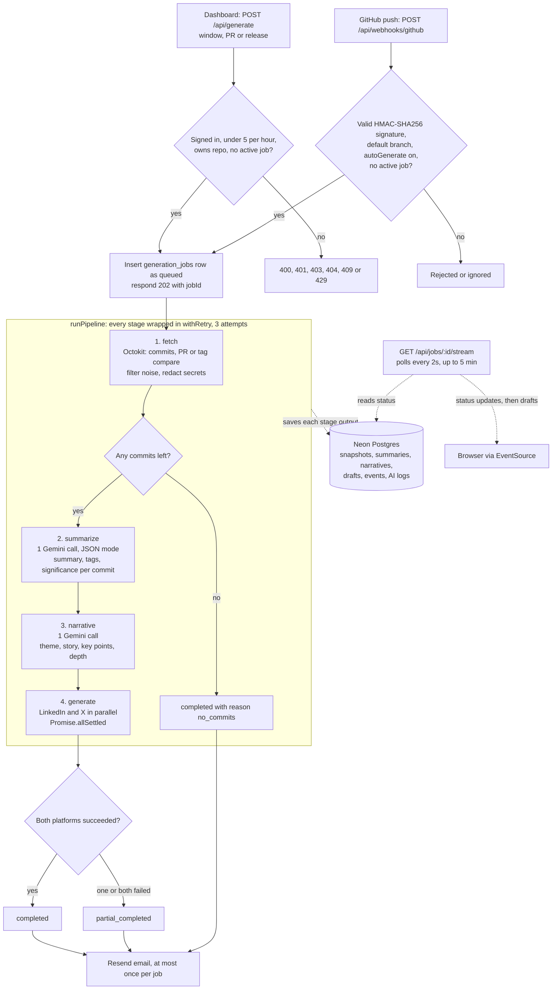

<div align="center">

# CommitFlex

**Turn the commits you shipped into LinkedIn and X posts that sound like you.**

CommitFlex reads your GitHub history (a date range, a single pull request or a release tag), runs it through a staged Gemini pipeline and hands back editable drafts written in your own voice. Connect a repo once and every push to the default branch can draft the posts for you.

[](https://commit-flex.vercel.app)


[Live demo](https://commit-flex.vercel.app) · [How it works](#how-it-works) · [Engineering decisions](#engineering-decisions) · [Run it locally](#getting-started)

</div>

---

## Why

Developers ship real work every week and almost never write about it. The commit log already tells the story, but turning `fix: race in webhook retry` into a post someone wants to read is a chore, so it doesn't happen.

CommitFlex does the first draft for you. It reads what was actually committed, drops the noise (bots, merges, version bumps, `wip`), redacts anything that looks like a secret, and writes one LinkedIn post and one tweet tuned to a saved voice profile: tone, technical level, audience and an optional "voice fingerprint" paragraph. You edit, copy and post.

## Features

**Generation**
- **Three sources:** a date window, a single PR (full URL or `owner/repo#123` shorthand) or a release tag, which is compared against the previous tag. All three are validated by one zod union in `lib/validators/jobs.ts`.
- **Automatic drafts on push:** connecting a repo installs a per-repo GitHub webhook with its own random 32-byte secret. Pushes to the default branch start a 7-day-window job, and each repo has an `autoGenerate` switch.
- **Live progress:** job status streams to the browser over Server-Sent Events while the pipeline runs.

**Drafts**
- Edit drafts in place, copy them (which marks the draft as copied) or regenerate a single draft from the stored narrative without redoing the whole run.
- **Variants:** generate 2 to 5 alternatives (3 by default) from Technical, Engagement and Creativity sliders. Creativity sets the model temperature directly (0.3 to 1.0), and the variants' creativity is spread evenly across ±15 points around the requested value so they actually read differently.

**Voice**
- Several voice profiles per user, with an atomic switch of the default. You can't delete the last profile, and deleting the default promotes the oldest remaining one.
- A voice-fingerprint API (`POST /api/voice/analyze`) turns 3 to 10 writing samples into a one-paragraph style guide.

**Account**
- GitHub sign-in (Auth.js v5, JWT sessions) and a multi-step onboarding flow: connect, pick a repository, set your voice, add optional writing-identity notes.
- A "generation complete" email via Resend and React Email, sent at most once per job and logged to the console when no API key is set.
- Notification preferences, a server-rendered dashboard, a drafts list and an analytics page (7-day generations vs. completions, completion rate, per-repo counts).
- One-click account deletion that cascades through every user-owned table via `ON DELETE CASCADE`.

## How it works



1. **Request.** `POST /api/generate` checks the session, applies a rate limit of 5 jobs per user per hour, validates the body, checks repo ownership (404 or 403) and returns `409` if a job is already running. It then inserts a `queued` job, starts the pipeline without awaiting it and responds `202 { jobId }` right away.
2. **Webhook.** `POST /api/webhooks/github` answers `ping`, ignores non-push events, reads the raw body once, looks up the repo by its numeric GitHub ID and verifies `X-Hub-Signature-256` against that repo's own secret. It applies a 10-per-minute repo rate limit only after the signature passes.
3. **Fetch** (`lib/pipeline/stages/fetch.ts`). It pulls commits with Octokit: paginated `listCommits` for a window, `pulls.get` + paginated `pulls.listCommits` for a PR, or `listTags` (latest 100 tags) + `compareCommits` for a release, falling back to `listCommits` up to the tag when there is no earlier tag. Bot authors, merge, chore, wip, fixup and squash commits, version bumps and reverts are dropped. Tokens, keys and `password=`-style strings are redacted, and the cleaned snapshot is saved.
4. **Summarize.** One Gemini call for all commits returns `{ sha, summary, tags, significance }` per commit.
5. **Narrative.** One Gemini call turns the summaries and voice settings into `{ theme, story, keyPoints, technicalDepth }`.
6. **Generate.** Two Gemini calls run in parallel, one for LinkedIn and one for X. Tweets longer than 280 characters are cut at a word boundary, and every draft is stored with a SHA-256 content hash.
7. **Finish.** The job ends as `completed`, `partial_completed` or `failed`. Every stage writes `pipeline_events`, and every Gemini call in the pipeline writes an `ai_generation_logs` row with token counts and an estimated cost.

A full run is **4 Gemini calls**. Regenerating a draft is 1 call and variants are 2 to 5. Both rebuild the narrative from the database, so summarize and narrative never run twice.

## Engineering decisions

| Decision | Where | Why it matters |
|---|---|---|
| **Staged pipeline with per-stage retry** | `lib/pipeline/run.ts` | Each of the 4 stages runs inside `withRetry` (3 attempts, 1s then 2s backoff), which emits a `stage_retrying` event and bumps `retry_count`. A flaky Gemini response re-runs one stage, not the whole job, and the saved results make regenerate and variants cheap. |
| **Hand-rolled circuit breaker** | `lib/ai/provider.ts` | Closed, open, then half-open over a fixed 5-minute window: it trips at a 50% failure rate once the window has at least 4 samples and cools down for 2 minutes. Every Gemini call shares one instance, so an outage fails fast instead of piling up retries. |
| **Per-repo webhook secrets, verified before rate limiting or job creation** | `app/api/webhooks/github/route.ts`, `lib/github/webhook.ts` | Every repo gets its own 32-byte HMAC secret. The signature is checked with `timingSafeEqual` (lengths compared first) against the raw body, and rate limiting comes after authentication so a stranger can't use up a repo's budget. |
| **Webhook install never blocks connecting** | `app/api/repos/route.ts` | If the `admin:repo_hook` scope is missing or GitHub returns 422, the repo still connects with `autoGenerate=false` and a warning. Disconnecting tolerates a 404 when removing the hook. |
| **Partial success instead of all-or-nothing** | `lib/ai/posts.ts`, `lib/pipeline/stages/generate.ts` | LinkedIn and X are generated with `Promise.allSettled`, so one platform failing gives `partial_completed`. The variants route catches errors per call and returns 502 only if every variant fails. |
| **Tolerant LLM output parsing** | `lib/ai/summarize.ts`, `lib/ai/narrative.ts`, `lib/ai/posts.ts`, `lib/ai/normalize.ts` | JSON mode plus three parse attempts (raw text, code fences stripped, regex extraction of the first `[...]`/`{...}`), an explicit `MAX_TOKENS` check, and normalizers that clamp scores to 1 to 10 and trim tweets instead of failing. |
| **Sliders that change the model, not just the prompt** | `lib/ai/posts.ts` | `creativityToTemperature` maps 0 to 100 onto temperature 0.3 to 1.0. All three dials are also bucketed (at 33 and 66) into low, mid and high descriptors that go into the prompt. |
| **SSE progress without a queue** | `app/api/jobs/[jobId]/stream/route.ts` | A `ReadableStream` polls the job row every 2s, sends an event only when the status changes, attaches the drafts once the job finishes and closes after 5 minutes. |
| **Commit hygiene before the LLM sees anything** | `lib/github/filter.ts`, `lib/github/sanitize.ts` | 4 bot authors, 6 message prefixes and 3 regex patterns filter out noise. 9 redaction patterns (GitHub tokens, `sk-` keys, Bearer tokens, AWS `AKIA` keys, `password=`/`secret=`/`token=`/`key=`) run before text reaches the prompt or the database. |
| **Voice profiles kept consistent in transactions** | `lib/db/queries/voice.ts` | Switching the default, refusing to delete the last profile and promoting a new default all run inside `db.transaction`. |
| **Notifications that can't break the pipeline** | `lib/pipeline/notify.ts`, `lib/mailer.ts` | An `email_log` lookup per (job, kind) makes pipeline retries safe, delivery is recorded as sent, failed or console-only, and the function never throws. |

### By the numbers

All counted from the source:

- **4** pipeline stages, **4** Gemini calls per run, **5** prompt templates (`lib/ai/prompts/*.md`)
- **18** API route files with **28** HTTP handlers, **9** pages
- **15** Postgres tables, **11** named indexes, **6** Drizzle migrations
- **9** job statuses, **3** generation sources, **4** rate-limited endpoints
- **221** test cases in **33** Vitest files covering AI, API routes, auth, components, DB, GitHub, the mailer and rate limiter, pipeline and types
- **4** security headers set in `next.config.mjs` (`X-Frame-Options: DENY`, `nosniff`, `Referrer-Policy`, `Permissions-Policy`)

## Tech stack

| Layer | Technology |
|---|---|
| Framework | Next.js 14.2 (App Router), React 18, TypeScript 5 |
| Auth | Auth.js / next-auth `5.0.0-beta.31` with the GitHub provider, JWT sessions and `@auth/drizzle-adapter` |
| Database | Neon PostgreSQL via `postgres` (postgres.js), Drizzle ORM and drizzle-kit |
| AI | Google Gemini `gemini-2.5-flash` via `@google/generative-ai` |
| GitHub | `@octokit/rest` (REST API) and push webhooks with HMAC-SHA256 verification |
| Validation | zod 4 |
| Email | Resend and `@react-email/components` |
| UI | Tailwind CSS 3, shadcn (base-nova) on `@base-ui/react`, lucide-react, `motion` for animation, SWR |
| Testing | Vitest 4, jsdom, Testing Library (react, jest-dom, user-event) |
| Tooling | pnpm, ESLint (`eslint-config-next`), tsx for scripts |
| CI / hosting | GitHub Actions (typecheck, tests, build on Node 20 with pnpm 9) and Vercel |

## Getting started

### Prerequisites

- Node.js 20 and pnpm 9 (the versions CI uses)
- A PostgreSQL database. The client connects with `ssl: 'require'`, so a hosted database such as [Neon](https://neon.tech) is the easiest option.
- A [GitHub OAuth App](https://github.com/settings/developers) with the callback URL `http://localhost:3000/api/auth/callback/github`
- A [Google Gemini API key](https://aistudio.google.com/app/apikey)
- Optional: a [Resend](https://resend.com) API key for email

### Setup

```bash
git clone https://github.com/ritvikjaiswal02/CommitFlex.git
cd CommitFlex
pnpm install

cp .env.example .env.local      # then fill in the values (see below)

pnpm db:migrate                 # applies the SQL migrations in ./drizzle
pnpm dev                        # http://localhost:3000
```

`pnpm db:migrate` runs `scripts/migrate.ts`, which loads `.env.local` itself, so it works outside Next.js.

### Scripts

| Command | What it does |
|---|---|
| `pnpm dev` | Start the Next.js dev server |
| `pnpm build` / `pnpm start` | Production build and serve |
| `pnpm lint` | `next lint` |
| `pnpm test` | Vitest in watch mode |
| `pnpm test:run` | Run the Vitest suite once |
| `pnpm db:generate` | Generate a new migration from `lib/db/schema.ts` |
| `pnpm db:migrate` | Apply migrations from `./drizzle` |
| `pnpm db:studio` | Open Drizzle Studio |

### Environment variables

| Variable | Required | Description |
|---|---|---|
| `DATABASE_URL` | Yes | Postgres connection string (SSL required) |
| `NEXTAUTH_URL` | Yes | Public app URL. Also used for email links and as the default webhook base URL |
| `NEXTAUTH_SECRET` | Yes | Secret used to sign Auth.js session JWTs, e.g. `openssl rand -base64 32` |
| `GITHUB_CLIENT_ID` | Yes | GitHub OAuth App client ID |
| `GITHUB_CLIENT_SECRET` | Yes | GitHub OAuth App client secret |
| `GEMINI_API_KEY` | Yes | Google Gemini API key |
| `OAUTH_TOKEN_ENCRYPTION_KEY` | Listed in `.env.example` | 64 hex chars (`openssl rand -hex 32`). Used by the AES-256-GCM helper in `lib/auth/encrypt.ts`, which isn't wired in yet (see [Roadmap](#roadmap)) |
| `RESEND_API_KEY` | No | Enables real email. When unset, emails are written to the console |
| `EMAIL_FROM` | No | Sender address. Defaults to `CommitFlex <onboarding@resend.dev>` |
| `WEBHOOK_BASE_URL` | No | Public origin GitHub sends push webhooks to. Falls back to `NEXTAUTH_URL`, then `VERCEL_URL`, then localhost |

> **Webhooks in local dev:** GitHub can't reach `localhost`. Set `WEBHOOK_BASE_URL` to a tunnel URL (smee.io or ngrok) before connecting a repo if you want push-triggered jobs locally. Manual generation works without one.

## Project structure

```text
CommitFlex/
├── app/                      # Next.js App Router
│   ├── page.tsx              # Animated landing page
│   ├── login/ onboarding/ dashboard/ repositories/
│   ├── drafts/ analytics/ settings/ jobs/[jobId]/
│   └── api/                  # 18 route files
│       ├── generate/         # Start a job (window | pr | release)
│       ├── jobs/[jobId]/     # Job status, cancel, SSE stream
│       ├── drafts/[draftId]/ # Edit, copy, replace, variants
│       ├── repos/ github/    # Connect repos, list GitHub repos
│       ├── voice/            # Profiles CRUD, default switch, analyze
│       ├── notifications/ user/
│       └── webhooks/github/  # HMAC-verified push webhook
├── auth.ts                   # Auth.js config (GitHub, JWT, Drizzle adapter)
├── middleware.ts             # Route guard
├── lib/
│   ├── ai/                   # Gemini client + circuit breaker, summarize,
│   │   └── prompts/          #   narrative, posts, voice analyzer, 5 .md templates
│   ├── pipeline/             # run.ts orchestrator, stages/, notify.ts
│   ├── github/               # Octokit fetchers, filter, sanitizer, webhook HMAC
│   ├── db/                   # schema.ts (15 tables), client, 10 query modules
│   ├── validators/           # zod schemas
│   ├── auth/                 # Ownership checks, AES-256-GCM helper
│   ├── email/ mailer.ts      # React Email templates, Resend wrapper
│   └── rate-limit.ts         # Fixed-window limiter
├── components/               # 11 feature components + 8 shadcn/ui primitives
├── drizzle/                  # 6 SQL migrations + snapshots
├── scripts/migrate.ts        # Migration runner
├── tests/                    # 33 Vitest files
├── types/                    # Shared TypeScript types
└── .github/workflows/ci.yml  # Typecheck, test, build
```

## Deployment

The live app runs on Vercel at [commit-flex.vercel.app](https://commit-flex.vercel.app).

1. Import the repo into Vercel. Next.js and pnpm are detected automatically.
2. Add the environment variables above, with `NEXTAUTH_URL` set to your production URL.
3. Create a production GitHub OAuth App (or add a second callback) pointing to `https://<your-domain>/api/auth/callback/github`.
4. Run `pnpm db:migrate` against the production `DATABASE_URL` once before the first deploy and again after every schema change.

The app sets `X-Frame-Options`, `X-Content-Type-Options`, `Referrer-Policy` and `Permissions-Policy` headers on every route via `next.config.mjs`.

## Roadmap

These are planned improvements, not shipped features. Several come straight from known gaps in the current code:

- [ ] **Durable job execution.** The pipeline starts fire-and-forget after the `202`. Moving it to `waitUntil` or a queue (QStash, Inngest) would make sure serverless runs finish.
- [ ] **Shared rate limiting and breaker state.** Both live in memory per instance today. Redis would make them global across instances.
- [ ] **Encrypt GitHub tokens at rest.** `lib/auth/encrypt.ts` (AES-256-GCM, already tested) is ready to wrap the adapter's `access_token`.
- [ ] **Real job cancellation.** `DELETE /api/jobs/:id` marks a job `cancelled`, but the pipeline doesn't check that flag between stages yet.
- [ ] **Voice fingerprint UI.** The analyzer endpoint exists, but no screen calls it yet.
- [ ] **Weekly digest email.** The template exists but isn't scheduled yet.
- [ ] **Accurate AI cost logging.** Record the real model name, Gemini pricing, prompt and output text and call duration in `ai_generation_logs`.
- [ ] **Working analytics ranges.** Hook up the 7D/30D/90D range buttons.
- [ ] **Validate AI output with zod.** Use the existing `lib/validators/ai.ts` schemas in the AI modules, alongside the hand-written normalizers.
- [ ] **More platforms.** Bluesky, Threads and Mastodon formats on top of the same narrative stage.

## Author

**Ritvik Jaiswal**

[](https://github.com/ritvikjaiswal02)

If CommitFlex gave you a post worth sharing, a star on the repo is appreciated.
